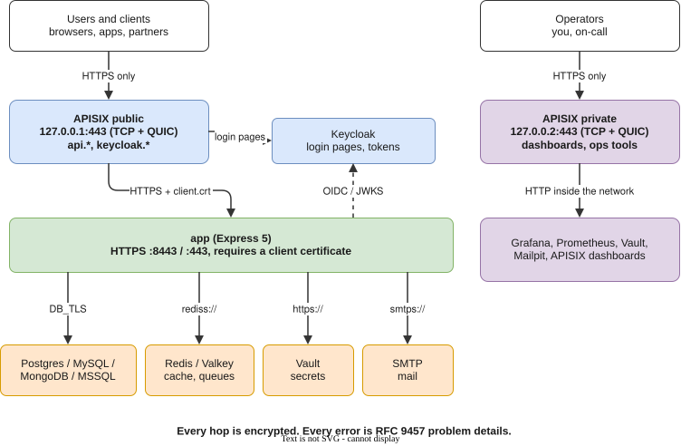

# Documentation

How to use this repository, from a first local run to production on Kubernetes, and how the parts fit together.

| Guide                           | Read it when you want to                                                                   |
| ------------------------------- | ------------------------------------------------------------------------------------------ |
| [Local setup](local-setup.md)   | run the API on your machine: certificates, hosts names, trusting the CA, `pnpm dev`        |
| [Generator](generator.md)       | start a new project with only the features you need, or generate code inside one           |
| [Docker compose](docker.md)     | run the whole stack (two gateways, app, databases, identity, observability) locally        |
| [Kubernetes](kubernetes.md)     | deploy with the Helm chart and the two APISIX gateways, on kind first, then a real cluster |
| [Architecture](architecture.md) | understand the layers, a request's path, dependency injection, errors and TLS              |

In a generated project, the parts about features you did not pick do not apply: their code, services and routes were removed.

## The big picture



Three rules hold everywhere, from `pnpm dev` to production:

1. **One port, always TLS.** Every server listens on 443 with HTTPS only. A plain `http://` request to 443 gets a `308` to `https://`; there is no port 80.
2. **Two gateways.** The public one serves what users reach. The private one serves operator tools. They have separate control planes and config, so a tool can never leak onto the public address.
3. **Errors are problem details.** The app, and the gateways in front of it, answer every error as RFC 9457 `application/problem+json`. No stock error pages and no `Server` header.

## Which path to take

| You want to                         | Start with                                                              |
| ----------------------------------- | ----------------------------------------------------------------------- |
| Build an API on this base           | `pnpm create expresso my-api`, then [Generator](generator.md)           |
| Hack on the API alone, fast reloads | [Local setup](local-setup.md), `pnpm dev`                               |
| See everything running together     | [Docker compose](docker.md), `docker compose --profile full up --build` |
| Ship it                             | [Kubernetes](kubernetes.md)                                             |
| Change the template itself          | [AGENTS.md](../AGENTS.md) (rules) and [Architecture](architecture.md)   |

## Diagrams

Every picture in these pages is a drawio file in [`diagrams/`](diagrams), exported to SVG. Edit the `.drawio` file in the drawio app (desktop or web), then export again:

```sh
cd docs/diagrams && for f in *.drawio; do drawio -x -f svg -o "${f%.drawio}.svg" "$f"; done
```
