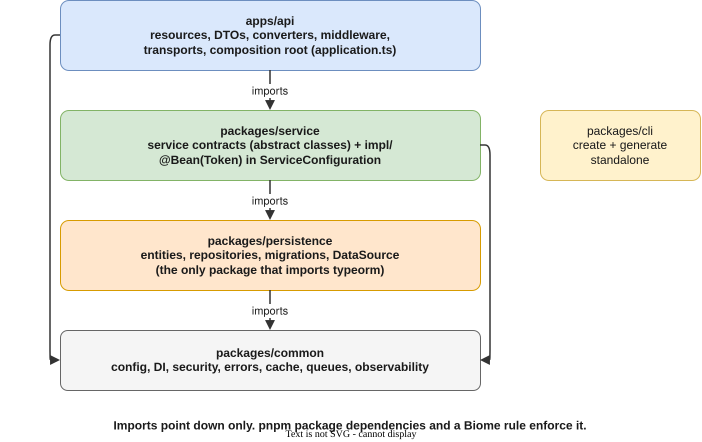
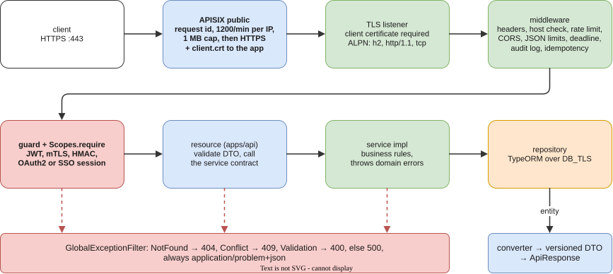
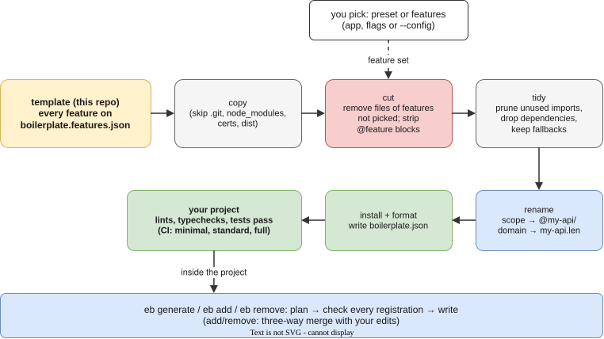

# Architecture

How the code is laid out, what happens to a request, and why each piece is where it is. The rules that keep it this way are in [AGENTS.md](../AGENTS.md).

## Packages and layers



| Package                | Holds                                                                                                | May import          |
| ---------------------- | ---------------------------------------------------------------------------------------------------- | ------------------- |
| `apps/api`             | REST resources (controllers), request DTOs, converters, middleware, transports, the composition root | service, common     |
| `packages/service`     | business logic: service contracts and their implementations                                          | persistence, common |
| `packages/persistence` | entities, repositories, migrations, the DataSource                                                   | common              |
| `packages/common`      | config, DI, security (guards, scopes), errors, cache, queues, observability                          | nothing             |
| `packages/cli`         | the generator. Standalone                                                                            | nothing             |

Dependencies point down only. pnpm enforces it: a package can only import what its `package.json` lists. A Biome rule also stops `apps/api` from reaching into persistence, except for entity types in converters and in `application.ts`.

In development and tests, packages are loaded from `src/` through the `source` export condition, so there is no build step. `pnpm build` and the Docker image use `dist/`.

## A request, end to end



1. **Gateway.** The client connects to the public APISIX on 443 and the gateway terminates TLS. It then:
   - adds `X-Request-Id`
   - applies the coarse per-IP limit (1200 a minute) and the 1 MB body cap
   - opens a new TLS connection to the app, presenting `client.crt`
2. **TLS at the app.** `main.ts` serves HTTPS only. With `TLS_CLIENT_AUTH=require`, a connection without a valid client certificate fails the handshake. HTTP/1.1 and HTTP/2 share the port, and the TCP transport joins them through ALPN.
3. **Middleware**, in the order `Application.init` adds it:

   | Step             | What it does                                                  |
   | ---------------- | ------------------------------------------------------------- |
   | security headers | helmet, a strict CSP, HSTS outside development                |
   | request id       | keeps the gateway's `X-Request-Id`, so one id spans both logs |
   | metrics          | records the request for metrics                               |
   | host validation  | rejects an unexpected `Host`                                  |
   | rate limit       | the app's finer limit                                         |
   | `OPTIONS`        |                                                               |
   | CORS             |                                                               |
   | cross-site check |                                                               |
   | cookies          |                                                               |
   | body parsing     | JSON only, with depth and size limits                         |
   | API version      |                                                               |
   | cache control    |                                                               |
   | deadline         | a per-request time limit                                      |
   | audit log        |                                                               |
   | idempotency keys |                                                               |

4. **Guard and scopes.** `@UseGuard(JwtGuard)` authenticates the caller. The guard can also be mTLS, HMAC, OAuth2 or an SSO session. Then `Scopes.require('users:write')` authorizes the call. A route without a guard must be listed in the route-audit test as public on purpose.
5. **Resource.** It validates the body into a DTO and calls the service by its contract (`UserService`), never by its implementation.
6. **Service.** `UserServiceImpl` holds the business rules. It calls the repository and the cache, and it can send mail and enqueue jobs. When something is wrong it throws a domain error: `NotFoundException`, `ConflictException` or `ValidationException`. It never builds an HTTP response.
7. **Repository and database.** The repository runs TypeORM over an encrypted connection (`DB_TLS`).
8. **Response.** The converter turns the entity into the versioned DTO (`UserV1Dto`, `UserV2Dto`). The response is wrapped in `ApiResponse`.
9. **Errors.** `GlobalExceptionFilter` maps every error to RFC 9457 problem details. Domain errors become 404, 409 or 400, and anything unknown becomes 500 without internals. Gateway-made errors use the same shape, so a client parses one format.

## Dependency injection

A service is two classes and one binding:

```ts
// packages/service/src/service/user.service.ts: the contract, and the DI token
export abstract class UserService {
  abstract findById(id: string): Promise<User>;
}

// packages/service/src/service/impl/user.service.impl.ts
@Service()
export class UserServiceImpl extends UserService {
  constructor(@inject(UserRepository) private readonly users: UserRepository) {
    super();
  }
  async findById(id: string): Promise<User> {
    const user = await this.users.findOneBy({id});
    if (!user) throw new NotFoundException('User not found');
    return user;
  }
}

// packages/service/src/config/service.configuration.ts
@Configuration()
export class ServiceConfiguration {
  @Bean(UserService)
  userService(beans: BeanFactory): UserService {
    return beans.getBean(UserServiceImpl);
  }
}
```

- **The abstract class is the token.** Callers depend on `UserService`. Tests and features can bind another implementation without touching them.
- **Tokens are always named.** Every constructor parameter has `@inject(Token)` and every `@Bean` names its token. tsx and Vitest compile with esbuild, which emits no type metadata, so inferring the type would silently fail.
- **Each package has one `@Configuration` class.** `application.ts` loads common, persistence, service and the API's own configuration, so you can find every binding in four files.

## Optional features



The template ships with every feature switched on. `boilerplate.features.json` and the `@feature:` markers describe how to remove each one. The generator cuts what you did not pick, prunes imports and dependencies, renames the scope and domain, and installs. CI generates the three presets and runs lint, typecheck and tests on each. That way a feature can never leak into code that does not mark it. See [Generator](generator.md).

## TLS and certificates

| Hop                              | Encrypted with                                                                                             |
| -------------------------------- | ---------------------------------------------------------------------------------------------------------- |
| client → gateway                 | `server.crt` (local), or your public certificate (cert-manager, ACME)                                      |
| gateway → app                    | the app's certificate. The gateway presents `client.crt` to the app                                        |
| gateway ↔ etcd (compose)         | `etcd.crt` and `etcd-client.crt`, client certificates on every connection                                  |
| app → database, cache, mail, IdP | `DB_TLS`, `rediss://`, `smtps://`, `https://`. `AppConfig` refuses anything else in staging and production |
| pods (Kubernetes)                | `<release>-tls` from your `internal-ca` ClusterIssuer                                                      |

The gateway's `client.crt` is deliberately not the trusted proxy identity (`MTLS_TRUSTED_PROXY_CN`). So the app never believes an `X-Client-Cert` header that came through the gateway. End users who authenticate with mTLS connect straight to the app.

Locally, one name-constrained CA signs everything (see [Local setup](local-setup.md#2-certificates)). In production, each hop uses your real CA.

## Observability

| Signal  | Where it goes                                                                                           |
| ------- | ------------------------------------------------------------------------------------------------------- |
| logs    | Pino JSON on stdout, with the request id. Alloy ships them to Loki (compose)                            |
| metrics | `/metrics` (allowed from `OPS_ALLOWED_CIDRS` only), plus the gateways' `:9091`. Prometheus scrapes both |
| traces  | OpenTelemetry to Tempo. Grafana links traces, logs and metrics                                          |
| health  | `/livez` (the process), `/readyz` (its dependencies), `/actuator/health` (details for operators)        |

## Where to change what

| Change                     | Files                                                                                                   |
| -------------------------- | ------------------------------------------------------------------------------------------------------- |
| a new endpoint or resource | `pnpm eb g endpoint` / `resource` ([Generator](generator.md))                                           |
| a setting                  | `packages/common/src/config/app.config.ts` (validated) and `apps/api/.env.example`                      |
| a public host              | `deploy/apisix/seed.mjs` `publicResources()` and `PUBLIC_HOSTS` in `apps/api/scripts/generate-certs.ts` |
| an operator tool           | `ApisixSeed.TOOLS` and `PRIVATE_HOSTS`                                                                  |
| a gateway error page       | `deploy/apisix/config-dp.yaml` and `deploy/k8s/apisix/values.yaml` (keep them in step)                  |
| a Kubernetes setting       | `deploy/helm/express-boilerplate/values.yaml` and `environments/`                                       |
