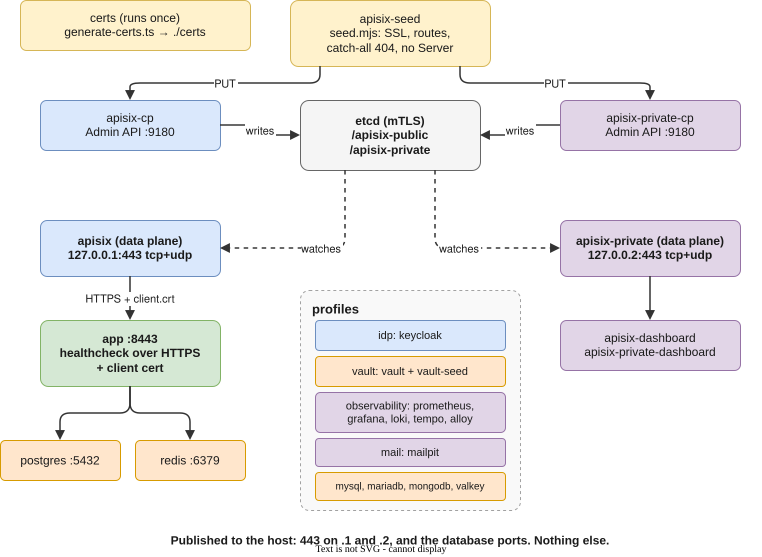

# Docker compose

`compose.yml` runs the stack the way production runs it: two APISIX gateways on 443, the app behind them over mutual TLS, and real databases. Do [Local setup](local-setup.md) steps 3 and 4 (hosts lines, trust the CA) first. The certificates themselves are made by compose.

In a generated project, services for features you did not pick are already removed from `compose.yml`.

## Start

```sh
docker compose up --build --wait                       # gateways + app + Postgres + Redis
APP_ENV_FILE=deploy/full-stack.env \
  docker compose --profile full up --build --wait      # plus identity, secrets, observability, mail
```

`--wait` returns once every service is healthy. The app's healthcheck calls it over HTTPS with a client certificate, so "healthy" means it really serves.

Then trust `./certs/ca.crt` (it is a separate CA from `apps/api/certs`) and open:

| URL                                                | Gateway | What                                                                      |
| -------------------------------------------------- | ------- | ------------------------------------------------------------------------- |
| `https://api.express-boilerplate.len/docs`         | public  | the API and Swagger (development mode)                                    |
| `https://localhost/livez`                          | public  | the API without a hosts entry                                             |
| `https://keycloak.express-boilerplate.len`         | public  | login pages, admin `admin`/`admin`, user `alice`/`alice` (`idp`)          |
| `https://dashboard.express-boilerplate.len`        | private | APISIX dashboard for the **private** gateway (`admin`/`admin`)            |
| `https://dashboard-public.express-boilerplate.len` | private | APISIX dashboard for the **public** gateway                               |
| `https://grafana.express-boilerplate.len`          | private | dashboard "API overview", logs, traces (`admin`/`admin`, `observability`) |
| `https://prometheus.express-boilerplate.len`       | private | metrics (`observability`)                                                 |
| `https://vault.express-boilerplate.len`            | private | secrets, token `dev-root-token` (`vault`)                                 |
| `https://mailpit.express-boilerplate.len`          | private | mail the app sends (`mail`)                                               |

Both dashboards sit on the private gateway: they configure gateways, so they are operator tools even when the routes they edit are public.

## What runs



| Service                                        | Role                                                                                                                       |
| ---------------------------------------------- | -------------------------------------------------------------------------------------------------------------------------- |
| `certs`                                        | runs `apps/api/scripts/generate-certs.ts` into `./certs` once. The CA is named after you (`CA_OWNER`)                      |
| `etcd`                                         | config store for both gateways, TLS with client certificates on every connection                                           |
| `apisix-cp`, `apisix-private-cp`               | control planes: the Admin API, each writing under its own etcd prefix. Not published                                       |
| `apisix-seed`                                  | runs `deploy/apisix/seed.mjs`: the certificate, the routes, the catch-all 404 and the no-`Server` rule. Idempotent         |
| `apisix`, `apisix-private`                     | data planes: the only things published, on 443 TCP (HTTP/1.1, HTTP/2) and UDP (HTTP/3)                                     |
| `apisix-dashboard`, `apisix-private-dashboard` | one dashboard per gateway                                                                                                  |
| `app`                                          | the API on 8443 (`NODE_ENV=development` unless set), settings from `.env` or `APP_ENV_FILE`. Requires a client certificate |
| `postgres`, `redis`                            | default database and cache. Published on 5432 and 6379 for your tools                                                      |

### Profiles

| Profile                                 | Adds                                                                                                                             |
| --------------------------------------- | -------------------------------------------------------------------------------------------------------------------------------- |
| `idp`                                   | Keycloak 26 with realm `demo`: OIDC login, and `api-client` for OAuth2 client credentials                                        |
| `vault`                                 | Vault in dev mode. `vault-seed` writes random `SESSION_SECRET`, `JWT_SECRET` and `HMAC_CLIENTS` once; the app reads them at boot |
| `observability`                         | Prometheus, Grafana, Loki, Tempo, Alloy                                                                                          |
| `mail`                                  | Mailpit                                                                                                                          |
| `full`                                  | all four above                                                                                                                   |
| `mysql`, `mariadb`, `mongodb`, `valkey` | another database or cache. Set `DB_TYPE`/`DB_URL` or `CACHE_URL` in `.env` (the header of `compose.yml` has the lines)           |

`deploy/full-stack.env` configures the app for the `full` profile: OIDC against Keycloak, Vault, metrics and traces, SMTP to Mailpit.

### Variables

Compose reads `.env` next to `compose.yml`.

| Variable                                       | Default                        |
| ---------------------------------------------- | ------------------------------ |
| `PUBLIC_IP`, `PRIVATE_IP`                      | `127.0.0.1`, `127.0.0.2`       |
| `DEV_DOMAIN`                                   | `express-boilerplate.len`      |
| `APISIX_ADMIN_KEY`, `APISIX_PRIVATE_ADMIN_KEY` | `dev-…-change-me`              |
| `APP_ENV_FILE`                                 | `.env`: the app's own settings |

## Errors you will see from the gateways

Nothing the gateways answer themselves is a stock page. All of it is problem details, with no `Server` header:

| Request                                      | Answer                                      |
| -------------------------------------------- | ------------------------------------------- |
| `http://…:443/`                              | `308` to `https://`                         |
| a host or path with no route                 | `404` (`routes/not-found`, lowest priority) |
| a tool host on the public address            | `404`: the public gateway has no such route |
| body over 1 MB                               | `413`                                       |
| more than 1200 requests a minute from one IP | `429` with `Retry-After`                    |
| app stopped or slow                          | `502`, `503`, `504`                         |

Errors the app produces pass through unchanged; they are problem details already. Where each is configured:

- the nginx-level errors (400, 408, 413, 5xx, the 308 redirect): `deploy/apisix/config-dp.yaml`
- the routes, 404 and 429: `deploy/apisix/seed.mjs`

## Try it

```sh
# from the folder with compose.yml: ./certs holds the compose CA
curl --cacert certs/ca.crt https://api.express-boilerplate.len/livez
curl --cacert certs/ca.crt --http3 https://api.express-boilerplate.len/livez         # curl built with HTTP/3
curl -i http://localhost:443/                                      # 308 problem details

# OAuth2 client credentials against Keycloak (idp profile)
TOKEN=$(curl -s --cacert certs/ca.crt https://keycloak.express-boilerplate.len/realms/demo/protocol/openid-connect/token \
  -d grant_type=client_credentials -d client_id=api-client -d client_secret=dev-api-secret-change-me | jq -r .access_token)
curl --cacert certs/ca.crt -H "Authorization: Bearer $TOKEN" https://api.express-boilerplate.len/api/v1/secure/oauth2
```

## Add a host

- **A user-facing service** (for example a web front end): add a route in `ApisixSeed.publicResources()` and the name in `LocalCertificateGenerator.PUBLIC_HOSTS`.
- **An operator tool:** add it to `ApisixSeed.TOOLS` and `PRIVATE_HOSTS`.

Then run `docker compose up -d apisix-seed` to reseed, and add the name to `/etc/hosts`. The wildcard certificate already covers it.

## Day to day

```sh
docker compose logs -f app apisix
docker compose up -d --build app           # rebuild only the app
docker compose run --rm apisix-seed        # reseed routes after editing seed.mjs
docker compose down                        # stop; -v also deletes the databases and etcd
rm -rf certs && docker compose up -d certs # new CA: trust it again
```

Everything in `deploy/` is development configuration: fixed demo passwords, Vault in dev mode, Alloy reading the Docker socket. Keep the shape, replace the secrets.

## The image

`Dockerfile` builds a multi-stage image that runs as the non-root `node` user on port 8443, with `dist/` only and production dependencies only. Certificates are mounted read-only at run time, and secrets come from the environment, never from build args. To pull the Node base image from another registry:

```sh
docker build --build-arg NODE_IMAGE=public.ecr.aws/docker/library/node:26-alpine .
```
