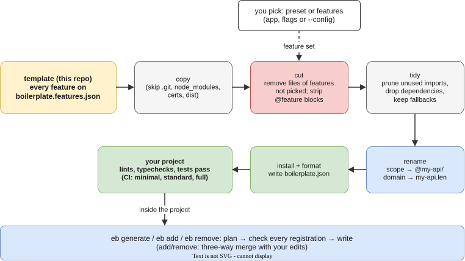

# Generator: create a project, generate code

The `create-express-boilerplate` package (`eb` for short) has two jobs:

- **create:** copy this template into a new project with only the features you pick.
- **generate:** inside a project, write new code through every layer and register it where the app looks.



Every command and flag is listed in [`packages/cli/README.md`](../packages/cli/README.md). This page is the walkthrough.

## Run it

| From                | Command                                                                                                                             |
| ------------------- | ----------------------------------------------------------------------------------------------------------------------------------- |
| anywhere (npm)      | `npx create-express-boilerplate my-api` or `pnpm create express-boilerplate my-api` or `pnpm dlx create-express-boilerplate my-api` |
| a template checkout | `pnpm eb create ../my-api`                                                                                                          |
| inside a project    | `pnpm eb` (the app) or `pnpm eb <command>`                                                                                          |

`eb` with no arguments in a terminal opens a full-screen app with a menu, a checklist, a preview of every file, a confirmation and live progress. The same commands also run with flags, which is what CI and scripts use. Without a terminal there are no prompts, and a missing argument is an error.

Where `create` gets the template:

| Situation                      | Template it copies                                                 |
| ------------------------------ | ------------------------------------------------------------------ |
| run from a checkout            | that checkout                                                      |
| run from the published package | the GitHub release tag matching the package version (`v<version>`) |
| `--template <dir>`             | that folder (your fork, for example)                               |
| `--ref <branch or tag>`        | that ref from GitHub                                               |

## 1. Create

```sh
npx create-express-boilerplate my-api                           # the app: pick features, preview, confirm
npx create-express-boilerplate my-api --preset minimal --yes    # core only, no questions
npx create-express-boilerplate my-api --features auth-oidc,redis,metrics
npx create-express-boilerplate my-api --config eb.config.json   # {"name", "preset" | "features", "install"}
npx create-express-boilerplate features                         # every feature and preset
```

Presets:

| Preset     | Features                                                                                         |
| ---------- | ------------------------------------------------------------------------------------------------ |
| `minimal`  | the core only: users, health, Actuator, JWT, scopes, API v1/v2, queues, Swagger, Postgres/sql.js |
| `standard` | core + mTLS, HMAC, OAuth2, Redis, metrics, tracing, WebSocket, SSE, Helm chart                   |
| `full`     | everything                                                                                       |

What you get:

- **Removed, not switched off.** Code for a feature you did not pick is gone: its files, dependencies, env settings, compose services, gateway routes, hosts names and tests. What is left lints, typechecks and passes its tests. CI checks the three presets on every push.
- **Renamed to your project.** The name (by default the folder name) becomes the package scope (`@my-api/common`) and the local domain (`https://api.my-api.len`).
- **Features recorded.** `boilerplate.json` lists the features you chose. `eb add` and `eb remove` read it.

Then follow [Local setup](local-setup.md) in the new folder (`pnpm install`, `pnpm certs`, the hosts lines, trusting the CA), or go straight to `docker compose up --build`.

## 2. Generate code

Each generator plans first and writes nothing unless every registration finds its place. Use `--dry-run` to print the plan. Running a generator twice never duplicates a registration. `--force` replaces the generated files, and your edits to them.

### A full CRUD resource

```sh
pnpm eb g resource order --fields title:string,total:int,paid:boolean
```

| Layer       | Written                                                                     | Registered                                                                          |
| ----------- | --------------------------------------------------------------------------- | ----------------------------------------------------------------------------------- |
| persistence | `entity/order.entity.ts`, repository, a `create_orders_table` migration     | entity list, migration list                                                         |
| service     | `service/order.service.ts` (contract), `service/impl/order.service.impl.ts` | `@Bean(OrderService)` in the configuration                                          |
| api         | request DTOs, converter, `rest/resources/v1/order.resource.ts`              | controller list, route constant, `orders:read` / `orders:write` scopes, OpenAPI tag |
| tests       | an integration test                                                         |                                                                                     |

```sh
pnpm eb migrate run          # create the table
pnpm dev                     # GET/POST/PUT/PATCH/DELETE https://api.<domain>/api/v1/orders
```

Field types: `string`, `text`, `int`, `boolean`. `id`, `createdAt` and `updatedAt` are added for you.

### One endpoint with its own business logic

```sh
pnpm eb g endpoint order --method POST --path /:id/approve --auth hmac --scope orders:approve
```

This adds a route to `OrderResource`, plus `approve()` on the `OrderService` contract and its implementation. Your business logic goes in that method. It also adds the `orders:approve` scope and a test. New routes go before the controller's existing ones, so `/stats` is not swallowed by `/:id`.

### Authentication per route

| Flag            | Who may call                                                                   | Needs the feature          |
| --------------- | ------------------------------------------------------------------------------ | -------------------------- |
| (default) `jwt` | a bearer JWT with the route's scope                                            | core                       |
| `--auth mtls`   | a client certificate signed by the trusted CA                                  | `auth-mtls`                |
| `--auth hmac`   | a client that signs each request with its shared secret                        | `auth-hmac`                |
| `--auth oauth2` | a token from your identity provider (introspected or JWKS-verified)            | `auth-oauth2`              |
| `--auth sso`    | a browser session from OIDC or SAML login                                      | `auth-oidc` or `auth-saml` |
| `--public`      | anyone. The route is listed in the route-audit test, so it is a visible choice | core                       |

On `resource` and `controller`, `--public` opens the reads only; writes still need the guard. If you ask for a method the project was created without, the generator refuses and prints the `eb add` command that turns it on.

### The other kinds

```sh
pnpm eb g service pricing                         # contract + @Service impl + @Bean + test
pnpm eb g migration add_status_to_orders --fields status:string
pnpm eb g exception payment-required --status 402 # domain exception, mapped in GlobalExceptionFilter
pnpm eb g job send-report                         # queue handler, registered in JobRegistry
pnpm eb g guard api-key                           # for @UseGuard(...)
pnpm eb g middleware request-timer                # app.use(...) in Application.init
pnpm eb g dto order-search --fields q:string,limit:int
pnpm eb g enum order-status --values draft,paid,shipped
```

## 3. Change features later

```sh
pnpm eb add websocket experiments    # turn on
pnpm eb remove experiments           # turn off
```

`add` and `remove` compare three versions: the template as you created it, the template with the new feature set, and your project. They apply the difference with a three-way merge, so your edits stay. When your edit and the feature touch the same lines, the file gets `<<<<<<<` conflict markers to resolve by hand, as in git. Commit before you run either command.

## 4. Inspect a project

```sh
pnpm eb info        # project, scope, domain, features, versions
pnpm eb doctor      # Node, pnpm, certs, hosts entries, port 443, Docker (exit 1 on a failure)
pnpm eb routes      # every route, method, guard and scope
pnpm eb migrate show
pnpm eb completion zsh > ~/.zfunc/_eb
```

## How the cutting works

`boilerplate.features.json` lists each feature: the files it owns (`remove`), the packages only it uses (`dependencies`) and the features it needs (`requires`). Code shared with other features sits between marker comments:

```ts
// @feature:<id>
registerTheFeature(); // only in projects that picked <id>
// @end:<id>
```

`#` replaces `//` in YAML and env files. A `// @feature:!<id>` block holds the fallback used only when the feature is off. Its lines start with `//~` so the template still compiles with everything on. After the cut, imports left unused are removed and the lockfile is pruned.

To add an optional feature to the template, see [Adding a feature](../packages/cli/README.md#adding-a-feature) and the rules in [AGENTS.md](../AGENTS.md#optional-features-the-generator).
